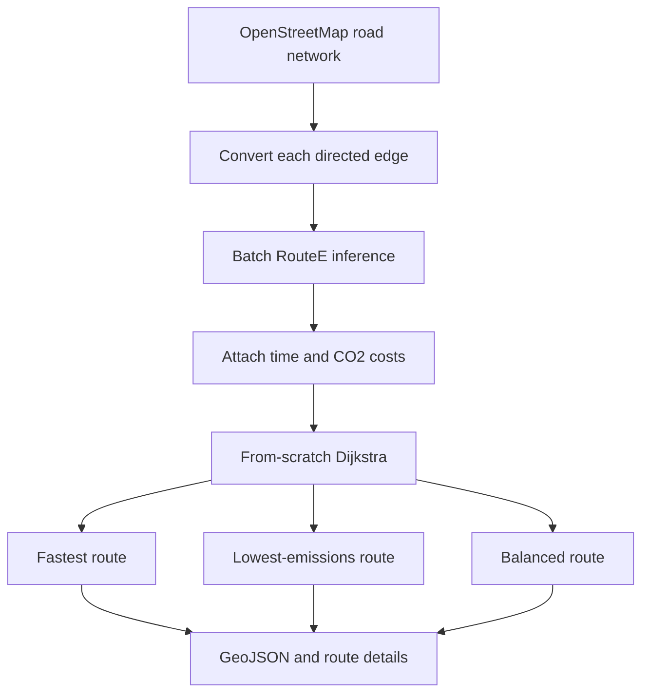

# Eco Route

A Python routing system that computes the fastest, lowest-emissions, and user-balanced driving routes over OpenStreetMap road networks.

The project implements Dijkstra's shortest-path algorithm directly rather than calling a library routing function. It preserves exact edges in an OSM directed multigraph, predicts segment-level fuel consumption with a pretrained RouteE model, and exports complete route geometry and metadata as GeoJSON.

## Highlights

- Implemented Dijkstra's algorithm from scratch in `routing.py`.
- Supports parallel directed road edges by preserving each exact `(u, v, key)` identity during relaxation and path reconstruction.
- Compares three objectives: travel time, predicted tailpipe CO2, and a user-controlled normalized combination of both.
- Batches ML inference across every road edge before routing, so the model is loaded once rather than called inside Dijkstra.
- Validates units, model inputs, output ordering, and finite nonnegative predictions before publishing costs to the graph.
- Includes offline tests for routing, multigraph edge selection, unit conversion, invalid model output, GeoJSON totals, landmarks, and explicit baseline behavior.

## System design



### Route objectives

For each edge `e`, the system defines:

- `time(e)`: estimated travel time in minutes
- `emissions(e)`: predicted tailpipe CO2 in grams
- `balanced(e)`: a weighted combination of normalized time and emissions

For an eco preference `w` between 0 and 1, the balanced edge cost is:

```text
(1 - w) * time(e) / fastest_route_time
+ w * emissions(e) / lowest_emissions_route_emissions
```

Because all component costs are nonnegative, Dijkstra remains valid for all three objectives. At `w = 0`, the balanced objective reduces to the fastest-route objective. At `w = 1`, it reduces to the lowest-emissions objective.

### From-scratch Dijkstra

`routing.py` maintains tentative costs and predecessor records, relaxes every outgoing parallel edge, and reconstructs both the ordered node path and the exact OSM edge keys. Keeping edge keys matters because two roads can connect the same pair of nodes while having different speeds, geometry, or emissions.

The current implementation uses a linear scan to choose the next unvisited node. This keeps the algorithm readable but gives approximately `O(V^2 + E)` time on a graph with `V` nodes and `E` directed edges. Replacing the scan with a binary heap is a clear future scalability improvement.

## Emissions model

The default emissions source is the RouteE Powertrain 2.x model:

```text
toyota/camry_ice/2016/rf_base_67ae9982/v1
```

Its verified inputs are `speed_mph` and `distance_mi`, and its output `fuel_gge` represents US gasoline gallons consumed on each segment.

Conversions are explicit:

```text
distance_mi = OSM length_m / 1609.344
speed_mph  = OSMnx speed_kph / 1.609344
emissions_g = fuel_gge * 8887
```

RouteE already incorporates distance and its real-world adjustment, so the application does not multiply the prediction by distance again or apply another correction. Every directed edge, including parallel edges, is predicted in one batch before routing.

The explicitly selectable `baseline` retains the original educational estimate:

```text
distance_miles * 120 + stops * 20 + elevation * 0.2
```

The current OSM loader supplies zero for stops and elevation, so this baseline reduces to 120 g/mile. It is preserved only for comparison and is not presented as a calibrated model.

## Verified behavior

Real RouteE inference produced:

| Segment | Predicted fuel | Predicted tailpipe CO2 |
|---|---:|---:|
| 1 mile at 30 mph | 0.03285837 gal | 292.012 g |
| 2 miles at 60 mph | 0.05921797 gal | 526.270 g |

The project also verifies that:

- predictions remain aligned with their input edges;
- invalid or non-finite inputs and outputs fail explicitly;
- no silent fallback replaces a failed RouteE prediction;
- route totals sum the exact selected edges;
- imports do not load a model, download OSM data, or prompt for input;
- optional landmark-service failures do not prevent route export.

## Output

Each run exports:

- `fastest.geojson`
- `lowest-emissions.geojson`
- `balanced.geojson`

Each GeoJSON FeatureCollection contains route geometry, aggregate totals, ordered segment metadata, exact edge identifiers, street names, distances, travel times, fuel consumption, emissions, and optional nearby landmarks.

## Run

Use Python 3.12 in a virtual environment:

```sh
python3.12 -m venv .venv-routee
.venv-routee/bin/python -m pip install -r requirements.txt
```

Run with RouteE:

```sh
.venv-routee/bin/python routing.py \
  --place "San Ramon, California, USA" \
  --output-dir output \
  --emissions-source routee
```

Run with the original baseline for comparison:

```sh
.venv-routee/bin/python routing.py \
  --place "San Ramon, California, USA" \
  --output-dir output-baseline \
  --emissions-source baseline
```

The program asks for an eco preference and start/destination coordinates. Coordinates are snapped to road nodes. The CLI prints route metrics and ordered road segments, while the complete geometry is written to GeoJSON.

OSM loading requires network access. If the RouteE model is already cached, its real prediction check can run offline:

```sh
HF_HUB_OFFLINE=1 .venv-routee/bin/python powertrain.py
```

## Tests

```sh
.venv-routee/bin/python -m unittest discover -s tests -v
```

Offline tests mock model predictions and cover batch inputs, unit conversion, fastest versus greenest parallel roads, balanced-objective endpoints, selected-edge totals, GeoJSON exports, invalid inputs and outputs, baseline selection, geometry, street names, landmarks, and path reconstruction.

## Project structure

| File | Responsibility |
|---|---|
| `routing.py` | From-scratch Dijkstra, path reconstruction, and three route objectives |
| `routes.py` | OSM loading, graph conversion, unit conversion, and edge prediction |
| `powertrain.py` | RouteE model loading, contract validation, and batch inference |
| `models.py` | Edge time, emissions, and balanced-cost definitions |
| `route_details.py` | Route summaries, geometry, landmarks, and GeoJSON export |
| `user_interface.py` | Input validation and readable terminal output |
| `tests/` | Offline routing, model-contract, geometry, and export tests |

## Limitations and future work

- Speeds come from OSM tags and OSMnx imputation, not observed traffic.
- Predictions assume a 2016 gasoline Toyota Camry.
- Tailpipe CO2 excludes upstream emissions, other greenhouse gases, grade, weather, and driving behavior.
- The system does not currently model live traffic, stop frequency, or elevation.
- Coordinates are snapped to road nodes, which can introduce access-point error.
- The linear-scan Dijkstra implementation favors clarity over performance on very large graphs.
- Route-level field testing is still needed before interpreting estimated differences as real-world emissions savings.

These constraints are kept explicit so the output is treated as an optimization estimate rather than a measurement.
